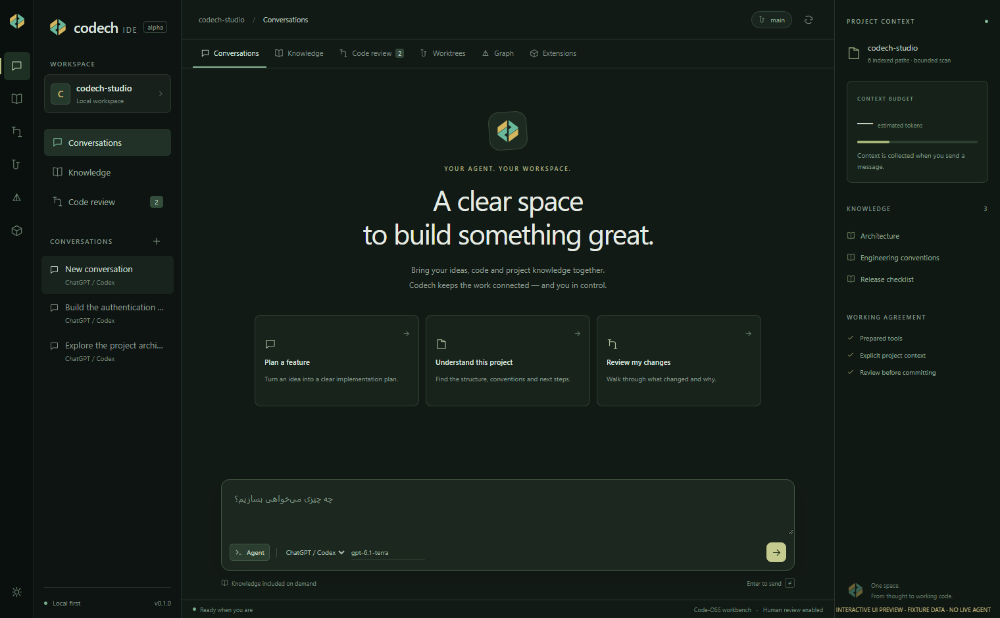

<p align="center"></p>
<h1 align="center">Codech IDE</h1>
<p align="center">Code. Conversations. Knowledge. One workbench.</p>
<p align="center"><strong>Development alpha · MIT · Code-OSS target</strong></p>

Codech is an agent-first development environment designed around a central conversation, native code editors, linked local knowledge and deliberate human code review. Its visual identity follows Codech's geometric mark, forest green and warm gold.

**Current release:** a functioning VS Code / Code-OSS workbench extension, a shared interactive UI preview, a bounded agent harness, and a pinned source-preparation path for a future independent Code-OSS distribution. **This repository does not yet ship a standalone desktop installer or a complete Obsidian/PyCharm replacement.**



## Try it

Requires Node 22+, Git, and a desktop VS Code / compatible Code-OSS host. The Codex provider additionally requires a separately installed Codex CLI. No account or API key is needed for the UI preview, local notes, import graph or Git inspection.

```sh
npm install
npm run typecheck
npm test
npm run package
npm run dev
```

`npm run dev` opens an isolated development profile against `examples/starter`; your normal editor profile is not modified. Set `CODECH_CODE_BINARY` to an absolute executable path when the default host is elsewhere. Alternatively, install `codech-workbench-0.1.0.vsix` using **Extensions → Install from VSIX**, then run **Codech: Open Workbench**. Select **Codech Forest** in the host's color theme picker for the matching editor theme.

```sh
npm run preview
# http://127.0.0.1:4173 — clearly labelled fixture preview, not a live IDE backend
```

## What works in 0.1

- Central conversation editor; native source and diff tabs open beside it; chats, notes and review entry points in the activity bar.
- Codex App Server JSON-RPC integration: isolated auth/config home, ChatGPT sign-in, model catalog, streaming text, command/file approvals, thread continuation and cancellation.
- OpenAI Responses API integration: SecretStorage key, prepared file/search/Git/check/proposal tools, bounded turns, human approval before applying edits, optional checks with explicit confirmation.
- Local Markdown vault in `.codech/knowledge/`, `[[wikilinks]]`, note creation, backlinks represented as graph edges, and bounded project context packets.
- TypeScript/JavaScript/Python import scanning and a navigable source graph. This is a bounded static scan, not a full language-server dependency analysis.
- Git status and native diffs; approvals tied to a digest of the reviewed file contents; commit reviewed paths through an isolated Git index; new Git worktrees and conversation selection per worktree.
- Optional loopback Graphiti MCP connection check and project-scoped semantic fact search. The service, extraction and embeddings are separate setup; see [Graphiti](docs/GRAPHITI.md).
- VSIX installation through the host, an Obsidian manifest inspector, theme, keyboard shortcuts, and a pinned Code-OSS preparation script.

## Honest boundaries

| Requirement | Current state | Remaining work |
|---|---|---|
| Independent Code-OSS desktop app | Pinned source + product overrides + built-in extension prep | Full workbench integration, platform builds, signed installers and update service |
| VS Code extensions | Host runtime and VSIX install | Open VSX distribution validation; some Microsoft extensions have separate restrictions |
| Obsidian experience | Markdown notes, wiki links, graph, native editing | Live-preview Markdown editor, properties, Canvas, Bases and compatibility host |
| Obsidian plugins | Manifest inspection only | Implement and test a documented API subset in a separate host; no blanket compatibility promise |
| PyCharm Professional workflow | Native VS Code host facilities | Keymap import, Django run configurations, database tools and refactoring parity matrix |
| Agent harness | Codex bridge + prepared API tool loop | Durable task event store, stronger orchestration, rollback and cost/quality benchmarks |
| Graphiti memory | Optional MCP adapter | Service lifecycle management, reviewed ingestion, source attribution, expiry and automatic retrieval |
| GitHub Desktop-style flow | Worktrees, status, diff, review, reviewed commits | Sync UI, PR publishing and review threads |

ChatGPT and API access follow their provider's current availability and usage rules. Choosing `gpt-6.1-terra` requests that model; catalog membership is not proof of entitlement. This project never reads another application's auth files and does not scrape ChatGPT sessions.

The current context planner reduces the amount of project data included by construction. **No percentage of token savings or model-quality parity is claimed without benchmarks.**

## Project guide

- [راهنمای فارسی و محدودهٔ محصول](docs/FA.md)
- [Architecture and harness](docs/ARCHITECTURE.md)
- [Compatibility](docs/COMPATIBILITY.md)
- [Independent desktop build](docs/DESKTOP.md)
- [Graphiti setup](docs/GRAPHITI.md)
- [Development roadmap](docs/ROADMAP.md)
- [Verification record](docs/VERIFICATION.md)
- [Sources](docs/SOURCES.md)

Codech code is MIT licensed. Code-OSS, Graphiti, extensions and other dependencies retain their own licenses. The Codech name and logo identify this project; the software license grants rights to the code, not rights to impersonate the brand. Codech is independent of Microsoft, OpenAI, Obsidian and JetBrains.
