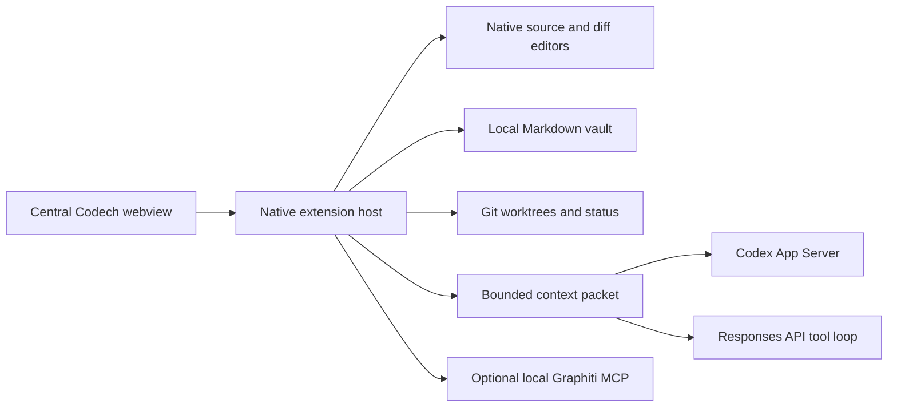

# Architecture

The end product is a Code-OSS distribution with a first-party workbench, not a new editor engine. Reusing the actual extension host, text buffers, language server integration, debugger, terminal, tasks and Git plumbing preserves the most useful compatibility surface. A Monaco-only Electron shell would not provide VS Code extension compatibility by itself.

## Current executable path

The renderer has no Node access, credentials or direct shell access. It sends a finite set of messages to the native host. A restrictive webview CSP allows only bundled scripts and styles. Dynamic text is HTML escaped. The host requires Workspace Trust before workspace tools, account connection and agent execution. APIs use native dialogs for credentials and execution approval.

## Harness

### Context plane

Scan a bounded file tree while skipping dependency, build, Git, environment and credential paths. Rank project instructions, READMEs, manifests and knowledge notes. Construct a context packet with a maximum character budget, source paths and content fingerprint. The UI displays newly attached characters, not a token estimate.

The file tree is rescanned each turn to detect current changes. Session fingerprints omit unchanged excerpts from continuing conversations. Scope/model changes, provider failures, fresh API chains and periodic refresh force full context; Codex compaction invalidates the snapshot. Snapshots are accepted only after provider acceptance. This is not a persistent symbol index or automatic semantic retrieval. File tools fetch additional source on demand.

### Execution plane

The Codex provider uses the official app-server's agent loop, prepared tools, permissions and supported skills/MCP configuration. It starts with a Codech-specific `CODEX_HOME`, `unlessTrusted` approval policy, a workspace-write sandbox and network disabled for the turn. App-server's own OS support and policy enforcement determine actual sandbox behavior. Codech does not independently implement an OS sandbox.

The API provider has `list_files`, `read_file` with line ranges, `search_code`, `inspect_git`, `code_graph`, `propose_edit`, and `run_check`. It never accepts an arbitrary shell string from the model. The check tool accepts only the fixed `test`, `typecheck` and `lint` names, then asks before executing project code. On Windows it invokes a fixed `npm run <approved-name>` command through the command interpreter; arguments are validated against the fixed allowlist.

The API loop has step and usage guards. Its configurable 16,000-token default guard is evaluated after an inference response, so the final response may exceed the guard. It is not a hard billing cap. API conversations use stored Responses and previous_response_id; this is not zero retention. Each response is limited to 3,000 output tokens by default. Tool output is bounded. After four completed turns by default, the chain renews with the original request, up to four recent excerpts and fresh project context; intervening history is explicitly omitted. Recorded input/output/cache usage comes from the provider response. This history window is configurable, and context-character reduction is not equivalent to lower billing.

### Review plane

API edits are proposals until the user applies them. Applying rejects stale preimages. Codex may edit working files under its permission policy; use a separate worktree to isolate its work. Review approvals hash the path plus before/after contents and expire on changes. Approvals are in-memory and reset when the host reloads. The user can commit reviewed paths through a temporary Git index; its staged contents are compared with the approved text, allowing standard CRLF-to-LF normalization, before committing. Other staged paths remain in the original index. Existing Git hooks still execute as trusted project code. This version has no agent-triggered commit/merge path, no hunk-level approval, and no promise of a tamper-proof review ledger. Renames and binary files remain available through native source control rather than the custom review list.

### State plane

Conversation metadata and text are saved in the host's workspace state. API keys use SecretStorage. The Codex home and worktrees live under Codech's extension global storage. Notes remain ordinary project files. Current persistence is not an append-only task event log. Closed clients decline pending simple command/file approvals; unsupported RPC requests fail closed.

## Target modules

1. `workbench`: native Code-OSS contributions for chat editors, workspace layouts and knowledge tabs.
2. `harness`: durable task state machine, capabilities, timeouts, replay, checkpoints and worktree lifecycle.
3. `context-engine`: incremental lexical/symbol index, budgeted retrieval, Graphiti provenance and decision memory.
4. `providers`: Codex, Responses API, future supported local/OpenAI-compatible providers.
5. `knowledge-host`: Markdown editor, local vault index, properties, links, embeds and plugin API compatibility.
6. `review-service`: snapshots, native/hunk diffs, requests for revision, test evidence and GitHub PR adapters.
7. `capability-registry`: discoverable tools, MCP adapters, supported skill packages, permissions and exact versioning.

## Quality gate before lower-cost model claims

Run the same versioned tasks on each candidate model. Track task success, regressions, review correction rounds, latency, uncached/cached input, output, tool failures and total cost. Include Django bugs, frontend work, migrations, database queries and broad refactors. Compare a cold start with indexed warm context. Promote a cheaper model for a task class only when its measured outcomes are acceptable. A strong harness improves tools and context; it cannot guarantee that all models have equivalent reasoning ability.
